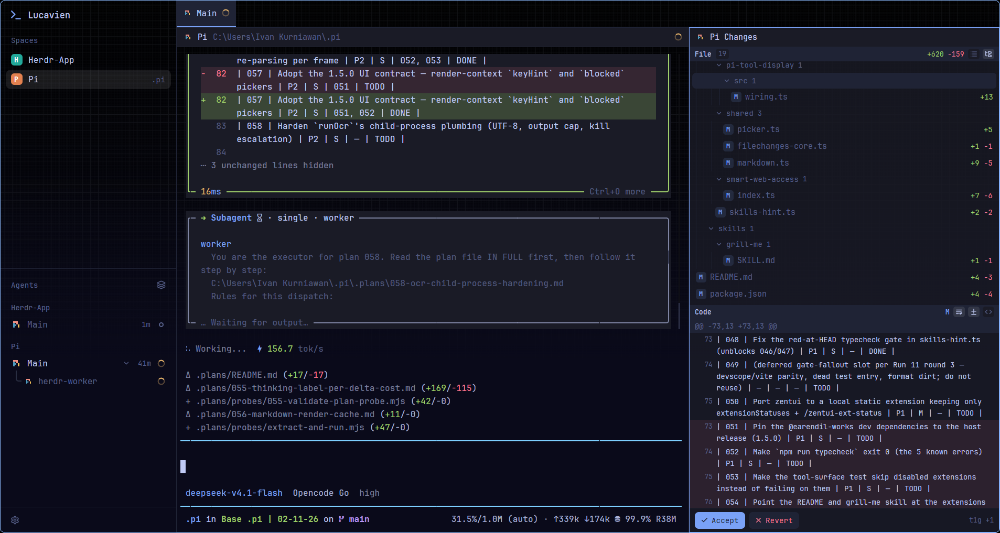

# herdr-van

A [Herdr app](https://herdr.dev) layout: Tokyo Night colors, a faded paper grid
behind the terminal and the sidebar. Your terminals sit straight on that
backdrop — no boxes, no bottom bar, no clutter.



## What you get

- **Indigo everywhere.** Tokyo Night Night (`#1a1b26`, blue accent `#7aa2f7`),
  taken from `tokyonight.nvim`'s WezTerm palette.
- **A grid behind your text.** The terminal, the sidebar and the tab bar sit on
  one faded paper grid (`backgrounds/tokyo-grid.png`); the bar has no fill of its
  own, so only the active tab and whatever the pointer is on are filled.
- **A sidebar that tells you what's happening.** Spaces as cards: their own icon in a
  frame, their git branch ahead/behind, and their runners under a divider with a
  hairline elbow and their outcome. No state words on a space — the agents list is where
  state lives. Saved workspaces as quieter cards. Agents as cards with a space-coloured
  spine, then the program's mark and the tab's name, its state mark at the right. A
  spinner while it works, a red badge when it needs you, a green dot when it's done; pin
  and settle on hover. Section headers are small caps in the group's colour with a hairline
  rule. Collapsed to the rail it keeps the logo where the wordmark was, and swaps it for
  the expand button under the pointer.
- **Agents you can name.** Right-click any agent or sub-agent row and pick **Rename
  agent…**: the list shows your name instead of the agent's own title, without
  touching the tab or the space. Empty it to get the title back.
- **Spaces with their own icon.** A space can wear any `.svg` or `.png` from
  `~/.config/herdr-app/custom-icons/`, picked from the row's hover button. The
  icon is kept with the space's workspace, so a closed and reopened space comes
  back wearing it, and `Default` in the picker puts the letter tile back.
- **A tab bar with nothing extra.** Pills, a `+` right after the last tab, one
  window-close button. No pill ✕, no Files/Changes buttons, no status bar.
- **The Pi logo.** Pi agents wear their real three-color logo instead of the
  plain glyph.
- **What's playing.** The bottom of the sidebar shows the cover art, title and
  artist of whatever plays on this machine, over a small live spectrum. The
  music-note button in the footer turns it off and back on; see
  [mods/media/README.md](mods/media/README.md) for what it needs.
- **Ctrl+B, like the TUI.** A small mod brings the [Herdr TUI](https://herdr.dev/tui)'s
  prefix into the app: Ctrl+B, then a key. Nothing opens over the terminal — a
  `⌥ Prefix` badge appears in the footer while it waits (on the rail, the bare
  glyph at the bottom of the agents list). `?` opens the guide.

## Add it

Open Herdr, start a coding agent, and paste this:

```text
Read ~/.config/herdr-app/AGENTS.md, then add this layout: https://github.com/VanKurnia/herdr-van
```

That's the whole install. The agent reads this repo, copies the files into
`~/.config/herdr-app`, merges the three key bindings, runs `herdr-app check` on
each mod, and switches to `herdr-van`. (It's the same "tell your agent" line
herdr.dev puts on its own layout pages.)

**Rather do it yourself?** Copy `layouts/`, `mods/`, `themes/`,
`backgrounds/`, `custom-icons/` and `programs.json` into `~/.config/herdr-app`,
add the [three keys](#keys), then run `layout.switch` to `herdr-van`.

Use real copies, **not symlinks** — Herdr's asset loader doesn't follow them, so
the icons and the background silently go missing.

## Needs

- The Herdr app (built against 0.1.10).
- `JetBrainsMono NFM` installed, for the UI font, and named by its typographic
  family (`JetBrainsMono Nerd Font Mono`) in the layout: Herdr resolves that name,
  and anything it can't resolve falls back to plain JetBrains Mono, which has no
  Nerd Font glyphs.
- Roughly a 1080p window. The backdrop is 2560×1440 and cover-fits.
- `python` on PATH for the now-playing row at the bottom of the sidebar, plus the
two dependency groups in [mods/media/README.md](mods/media/README.md). They are
installed into that mod's `vendor/`, which is not committed (52 MB of it is
numpy). Without them the row says `Media helper offline` and points at that
README.

## Keys

The layout itself adds none. `herdr-tui-prefix` needs these three, merged into
your `keys.json`:

```json
{
  "global": { "ctrl-b": "mod.open:herdr-tui-prefix" },
  "terminal": { "ctrl-b": "mod.open:herdr-tui-prefix" },
  "mod:herdr-tui-prefix": { "ctrl-b": "herdr-tui-prefix.send-prefix" }
}
```

Heads up: this takes Ctrl+B away from terminal programs, tmux included — same as
the TUI. Ctrl+B Ctrl+B still sends a literal prefix. Don't want that? Drop the
mod and those three lines; the layout works fine without it, and the footer's
badge never appears without the mod that sets it.

## Make it yours

The sidebar name is one string in `~/.config/herdr-app/herdr-van-config.json`:

```json
{ "brand": { "name": "Lucavien" } }
```

Empty (`""`) shows your username instead. Hovering the name always shows
"Herdr". Edits apply live.

## Keeping this repo in step

For whoever maintains it: the live Herdr home is the source of truth. Editing
there and committing here is the flow, so the hook at `.githooks/pre-commit`
runs `tools/sync-from-live.ps1` and then stages **only** what the sync writes —
`mods/`, `layouts/`, `themes/`, `backgrounds/`, `custom-icons/` and
`programs.json`. Nothing else is staged, so a stray file shows up in
`git status` instead of riding along unread; commit it yourself if it belongs.
The hook is tracked (unlike a file in `.git/hooks/`) so the rule is reviewable.

Activate it once per clone — `core.hooksPath` is local config, not a tracked
file:

```sh
git config core.hooksPath .githooks
```

`bench/results/` is tracked on purpose: a benchmark run adds one file, and
whoever runs it stages that file.

## What it touches

Nothing leaves your machine. For honesty's sake, here's every program these mods
run:

- `git status` / `rev-parse` for each space, so it can show branch and
  ahead-behind. Runs on the space's machine if the space lives on another one.
- `whoami` (once, for the default brand name) and one `powershell` call to see
  whether the config file is a symlink.
- `hc` — `machine ls`, and `keys ctrl+b` only when you press Ctrl+B twice.
- `python` — the hidden helper behind the now-playing row. It reads the Windows
media session and the default output device's loopback, and writes only inside
`~/.config/herdr-app/data/media`.

No network, no `fetch`, nothing written outside `~/.config/herdr-app`.

## Built from

`layouts/herdr-van.json` is a clone of the shipped `main` layout. `mods/herdr-van/`
is the window's chrome in one folder — tab bar, spaces list, agents list, brand
row, footer, and a pane header that reworks the shipped one — each a part of the
same mod, built from the shipped `spaces`, `agents`, `tabs`, `workspace-chrome`
and `pane`. `mods/herdr-filechanges/` is the Pi-Changes panel that header opens,
and `mods/herdr-tui-prefix/` the Ctrl+B prefix. `mods/media/` is the now-playing
row: a panel, a python helper that talks to the Windows media session, and the
launcher that starts it. `RECIPE.md` is the full build brief if you want to know
exactly what changed and why.

## License

MIT. Issues and PRs welcome — see [RECIPE.md](RECIPE.md) if you'd like to carry
a change upstream in a form that's easy to review.
