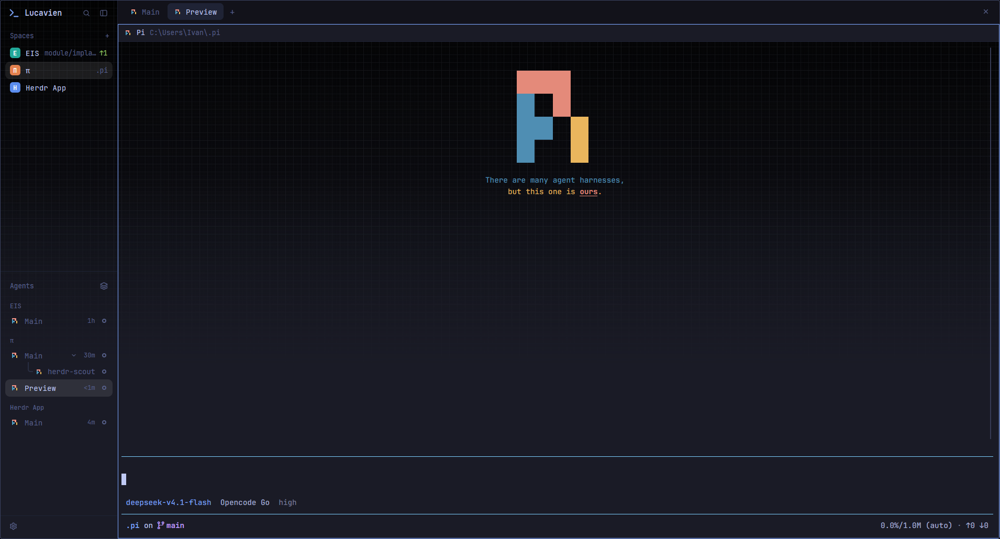

# herdr-van

Tokyo Night Night for the [Herdr app](https://herdr.dev): full-window indigo
theme over a WezTerm-style paper-grid backdrop, transparent sidebar and
terminal, custom tab bar, Pi logo program icon.

## Install

Copy `layouts/`, `mods/`, `themes/`, `backgrounds/`, `custom-icons/` and
`programs.json` into your Herdr home (`~/.config/herdr-app`), then switch to
the `tokyo-night` layout. Needs `JetBrainsMono NFM` for the UI font. See
[RECIPE.md](RECIPE.md) for the full build brief.

## Editing this layout

The Herdr home is the source of truth: edit the files there, then commit here.
`tools/sync-from-live.ps1` copies them in (`pwsh -File tools/sync-from-live.ps1`),
and an optional `.git/hooks/pre-commit` hook runs it automatically so a commit
always captures what you just changed.

Use real copies, not symlinks: Herdr's asset loader does not follow symlinked
paths — linked mod folders still run their JavaScript, but their SVGs and the
background image silently fail to load.
