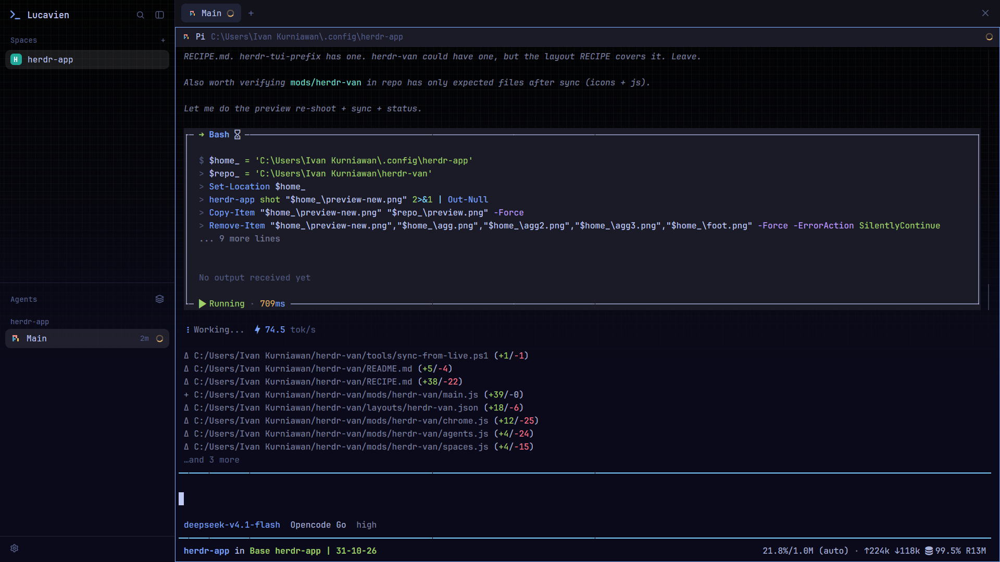

# herdr-van

A full-window Tokyo Night layout for the Herdr app, named `herdr-van` (its theme
is `tokyo-night`, so the two names differ on purpose). Terminal, sidebar, tab bar
all in `#1a1b26` indigo with `#7aa2f7` blue accents, over a WezTerm-style paper
grid that shows through the terminal and the sidebar alike.



Want it running? Don't build it by hand — tell your agent:

```text
Read ~/.config/herdr-app/AGENTS.md, then add this layout: https://github.com/VanKurnia/herdr-van
```

The rest of this file is the brief: enough for an agent to rebuild it from an
empty folder, or to review a change to it.

## What you see

Left to right. A transparent sidebar (268px) over the grid: a blue Lucide
terminal glyph next to the word **Lucavien** (it flips to **Herdr** on hover), a
search button and a collapse button, the spaces list with per-space color chips
and git branch tails, the agents list with status dots (amber spinner while working, a
green dot when done, red when blocked), and a 40px footer with a single settings gear. Nothing
else — no Files or Changes panel, no buttons for them in the tab bar, no bottom
status bar.

Top to bottom on the right. A 42px tab bar of rounded pills, no pill ✕, a `+`
tucked right after the last tab, one window-close button at the far right. Below
it, one borderless terminal card with square corners, zero gap and zero outer
padding: text in JetBrainsMono NFM (13px) sitting straight on the faint paper
grid, which fades to solid indigo near the bottom edge. A 30px pane header is
always visible, showing the program, the folder, and a spinner while an agent
works.

## How it behaves

- **Agent status colors** — working shows an amber spinner, done a green dot,
  blocked a red "Needs you" badge, idle a hollow ring. The same colors come back
  in tab pills and the terminal's own status.
- **Hovering the brand** swaps **Lucavien** back to **Herdr**; moving away
  restores it. Rows and buttons get the usual raised highlight, scoped to the
  control.
- **Tabs**: click to switch, double-click to rename, drag to reorder,
  right-click for the menu, scroll wheel to cycle. `+` opens the standard
  new-tab menu (terminal or any installed agent). Close with `ctrl-shift-w`
  (there is no pill ✕).
- **Spaces**: click to switch, right-click for the menu, drag to reorder. The
  avatar color is stored per space; git branch, ahead and behind appear after
  the name when they're unusual.
- **Ctrl+B** opens the herdr-tui prefix card (nine rows). `?` swaps it for the
  full table of herdr-tui's defaults and back without closing.
- The layout hides nothing you need: zoom, splits, the picker, the tab and space
  menus are all the shipped ones.

## Built from

**Layout** `layouts/herdr-van.json` — a clone of the shipped `main`. The file
name is the layout name, so it must be `herdr-van.json`. Root look only:

```json
{ "theme": "tokyo-night", "font": "JetBrainsMono NFM", "font_size": 13,
  "ui_font": "JetBrainsMono NFM", "terminal_opacity": 0,
  "terminal_padding": [5, 2],
  "background": { "image": "backgrounds/tokyo-grid.png", "fit": "cover" } }
```

Plus `titlebar: "none"`, `traffic_lights: [12, 16]`, a 1px `border` divider.

The tree:

- `sidebar` (column, 268px, `background: #16161e00`, not resizable)
  - `brand` (block, 46px, `window_drag`) → `custom-chrome`
  - `sidebar-lists` (column)
    - `spaces` (block, weight 1, min 90) → `custom-spaces`
    - `agents` (block, weight 1, min 90) → `custom-agents`
  - `sidebar-footer` (block, 40px) → `custom-chrome`, `props: { footer: true }`
- `work` (column, not resizable)
  - `tabs` (block, 42px, `window_drag`) → `custom-tabs`
  - `work-body` (row, `padding: 0`)
    - `main` → `{ tab: "active", pane: {...} }` with `gap: 0`, `radius: 0`,
      `background: "#1a1b2600"`, 1px border, accent focus border, `lone: true`,
      and a `pane` header (mod `pane`, 30px, top, `reveal: "always"`)

The `panel` (files/changes) and `status` nodes are gone. Nothing else was
removed — panes still split, zoom and move exactly like `main`.

**Theme** `themes/tokyo-night.json` — the exact Tokyo Night Night palette from
`tokyonight.nvim`'s `extras/wezterm/tokyonight_night.toml`: bg `#1a1b26`, fg
`#c0caf5`, selection `#283457`, the stock 16 ANSI colors, and a `colors` block
mapping panel roles (chrome/surface `#16161e`, raised/hover/border `#1f2335`,
muted/dim `#565f89`, accent `#7aa2f7`, working `#e0af68`, blocked `#f7768e`,
done `#9ece6a`, idle/unknown `#565f89`).

**Backdrop** `backgrounds/tokyo-grid.png` — 2560×1440, pre-composed: a vertical
gradient `#000000` → `#1a1b26`, the WezTerm `grid-tile.png` lattice tiled at
40px, and the top-third-transparent fade baked in. Herdr takes one background
layer, so three WezTerm layers were flattened into one here.

**Mods.** All five are plain copies plus small edits:

- `custom-tabs` — shipped `tabs` minus the pill ✕, with `+` moved inside the tab
  scroll row and the minimize/maximize window buttons removed (close kept). The
  Files/Changes toggle buttons render **only** when the layout has a `panel` node
  *and* `shared("workspace.panels")` lists them, so this layout shows none and
  nothing needs to be configured.
- `custom-spaces`, `custom-agents`, `custom-chrome` — the shipped `spaces`,
  `agents` and `workspace-chrome` with only their root `.bg(t.chrome)` removed;
  hover, selected and border styling untouched (the sidebar node is transparent,
  so the grid shows through).
- `custom-chrome` also carries the brand and footer rework: Lucide
  `terminal.svg` in accent blue instead of the Herdr PNG, the
  Lucavien/Herdr hover swap, a search button, the collapse button, and a footer
  reduced to one 28px settings gear.
- `herdr-tui-prefix` — not part of the layout's look and needs no block, only
  keys, so it works in any layout. `mod.json` is `place: "none"` with a top
  popup (520 wide, offset 64). Ctrl+B opens a nine-row card (`SHORT`); `?` swaps
  it for the full table (`SECTIONS`, `INDEX`) of herdr-tui's
  `herdr --default-config` `[keys]` defaults and back. Rows with no Herdr-app
  command stay listed and dimmed with a reason (`r` resize, `[` copy mode,
  `tab`/`shift+tab` cycling, `e` scrollback, `shift+p` rename pane, `shift+r`
  reload, `o` notification target); pressing one posts a warning toast instead
  of doing nothing. Everything else dispatches `pane.*`, `tab.*`, `space.*`,
  `layout.toggle`, `window.minimize`, `app.settings`, or the shipped
  `picker`/`worktree` overlays. `q` minimizes where herdr-tui would detach, and
  `w`/`g` both open `picker`. A literal Ctrl+B goes out through
  `hc(["keys", terminal, "ctrl+b"])`.

**Pi logo** `custom-icons/pi.svg` is the official `pi.dev/logo-auto.svg`, wired
by `programs.json` (`pi` → `custom-icons/pi.svg`, `tint: false` so it keeps its
colors).

**Brand config** `herdr-van-config.json` at the Herdr home root:
`{"brand": {"name": ""}}` means this computer's username, any string pins it.
`custom-chrome` watches both the home folder and, if the file is a symlink, the
folder it points at, so edits from either side apply without a restart. Your copy
is yours: the repo ships only the empty template, and `tools/sync-from-live.ps1`
never copies it back.

**Keys** — merge, never replace:

```json
{ "global": { "ctrl-b": "mod.open:herdr-tui-prefix" },
  "terminal": { "ctrl-b": "mod.open:herdr-tui-prefix" },
  "mod:herdr-tui-prefix": { "ctrl-b": "herdr-tui-prefix.send-prefix" } }
```

**Programs it runs:** `git` (`status`, `rev-parse`) per space — on that space's
machine when it lives on another one — `whoami` once, one `powershell` call to
resolve a symlinked config, and `hc` (`machine ls`, plus `keys ctrl+b` only when
you press Ctrl+B twice). No network.

**Keeping repo and machine in step** — the Herdr home is the source of truth:
edit there, see it live, then run `pwsh -File tools/sync-from-live.ps1` and commit.
It skips app-generated files (`jsconfig.json`, `gpui-kit.d.ts`, `*.error`) and
the personal brand config.

## Watch out

- `terminal_opacity: 0` puts terminal text straight on the image. On a brighter
  grid, raise it to 0.7–0.85.
- The backdrop is a snapshot, not live: restyle WezTerm's grid and you must
  re-compose `backgrounds/tokyo-grid.png` (gradient fill, `TextureBrush` tile at
  40px, four-stop fade). It hot-reloads once replaced.
- Version skew: the mods record `cloned_from` 0.1.9 and the layout 0.1.8. On a
  newer Herdr, re-clone the four mods and re-apply the small diffs rather than
  keeping stale copies.
- Ctrl+B is taken from every terminal program, tmux included. Ctrl+B Ctrl+B
  reaches them. `?` is this mod's toggle, so `app.help` is not on the prefix.
- Rename and close space/tab open Herdr's own dialogs, because the app asks for
  the name itself. Dimmed rows close the card and post a toast.
- Sizes assume a 1080p+ window; the 2560×1440 backdrop is `cover`-fit and holds
  up on HiDPI, and the 40px grid pitch survives any size by construction.
- Layout files can lag the screen for a moment after an edit. A layout switch
  away and back forces a clean rebuild.

## Done when

- [ ] `layout.switch` to `herdr-van` shows the indigo window with the grid
      visible inside the terminal and behind the sidebar, brand top-left.
- [ ] `herdr-app status` has no `*.error`, and `herdr-app check` passes for each
      of the five mods.
- [ ] Tab pills have no ✕, `+` follows the last tab, there are no Files/Changes
      buttons, and there is no bottom status bar.
- [ ] A running Pi agent shows the three-color logo in the sidebar and its pill.
- [ ] Hovering the brand reads Herdr; hovering the gear highlights only the icon.
- [ ] Ctrl+B shows the nine-row card over any layout, `?` swaps it for the full
      table and back, `v` splits right, and Ctrl+B Ctrl+B types a prefix into the
      shell.
