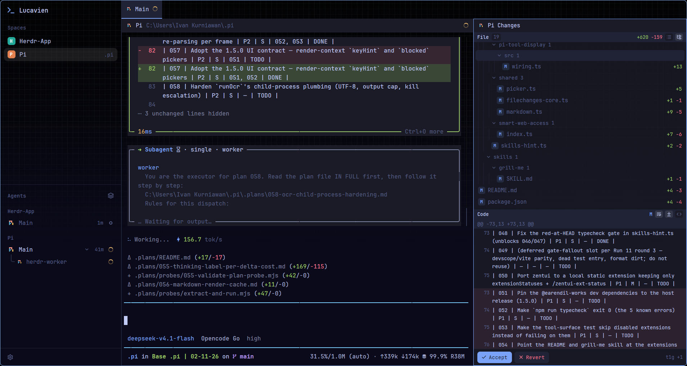

# herdr-van

A full-window Tokyo Night layout for the Herdr app, named `herdr-van` (its theme
is `tokyo-night`, so the two names differ on purpose). Terminal, sidebar, tab bar
all in `#1a1b26` indigo with `#7aa2f7` blue accents, over a WezTerm-style paper
grid that shows through the terminal and the sidebar alike.



Want it running? Don't build it by hand — tell your agent:

```text
Read ~/.config/herdr-app/AGENTS.md, then add this layout: https://github.com/VanKurnia/herdr-van
```

The rest of this file is the brief: enough for an agent to rebuild it from an
empty folder, or to review a change to it.

## What you see

Left to right. A transparent sidebar (268px) over the grid: a blue Lucide
terminal glyph next to the word **Lucavien** (it flips to **Herdr** on hover), a
search button and a collapse button, the spaces list with per-space color chips
and git branch tails, the agents list with status dots (amber spinner while working, a
green dot when done, red when blocked), and a 40px footer with a settings gear and, at
its right end, the herdr-tui `⌥ Prefix` badge — there only while Ctrl+B waits. Nothing
else — no Files or Changes panel, no buttons for them in the tab bar, no bottom
status bar.

Collapsed to the 44px rail, the brand row keeps only the glyph, centered where the
wordmark was, and swaps it for the collapse button while the pointer is on the
sidebar: the rail is never empty.

Top to bottom on the right. A 42px tab bar with no fill of its own, so the same
paper grid shows through it: every tab reserves a 2px bottom edge, the active one
underlined in the accent (`#7aa2f7`) and filled `#1f2335` — no side or top border on
any tab — the others underlined in nothing and unfilled until
the pointer is on them. No pill ✕, a `+` tucked right after the last tab, one
window-close button at the far right — both full bar height and square (42×42 at
this bar height), drawn only while the pointer is on the
bar, and filled `#1f2335` only while hovered. Below
it, one borderless terminal card with square corners, zero gap and zero outer
padding: text in JetBrainsMono Nerd Font Mono (13px) sitting straight on the faint paper
grid, which fades to solid indigo near the bottom edge. A 30px pane header is
always visible, showing the program, the folder, and a spinner while an agent
works.

## How it behaves

- **Agent status colors** — working shows an amber spinner, done a green dot,
  blocked a red "Needs you" badge, idle a hollow ring. The same colors come back
  in tab pills and the terminal's own status.
- **Hovering the brand** swaps **Lucavien** back to **Herdr**; moving away
  restores it. Rows and buttons get the usual raised highlight, scoped to the
  control.
- **Tabs**: click to switch, double-click to rename, drag to reorder,
  right-click for the menu, scroll wheel to cycle. `+` opens the standard
  new-tab menu (terminal or any installed agent). Close with `ctrl-shift-w`
  (there is no pill ✕).
- **Spaces**: click to switch, right-click for the menu, drag to reorder. While a
  row is dragged it dims, a 2px accent line marks the edge the space will land on
  (below when dragging down, above when dragging up), and a drop on another
  machine's row is refused (`space.move` stays inside a machine). The
  avatar color is stored per space; git branch, ahead and behind appear after
  the name when they're unusual.
- **Ctrl+B** opens nothing: a `⌥ Prefix` badge appears at the right end of the
  footer while the next key is expected (four seconds), then goes. `?` opens the
  guide — the full table of the bindings it keeps.
- The layout hides nothing you need: zoom, splits, the picker, the tab and space
  menus are all the shipped ones.

## Built from

**Layout** `layouts/herdr-van.json` — a clone of the shipped `main`. The file
name is the layout name, so it must be `herdr-van.json`. Root look only:

```json
{ "theme": "tokyo-night", "font": "JetBrainsMono Nerd Font Mono", "font_size": 13,
  "ui_font": "JetBrainsMono Nerd Font Mono", "terminal_opacity": 0,
  "terminal_padding": [5, 2],
  "background": { "image": "backgrounds/tokyo-grid.png", "fit": "cover" } }
```

Plus `titlebar: "none"`, `traffic_lights: [12, 16]`, a 1px `border` divider.

The tree:

- `sidebar` (column, 268px, `background: #16161e00`, not resizable)
  - `brand` (block, 46px, `window_drag`) → `herdr-van`, `props: { part: "brand" }`
  - `sidebar-lists` (column)
    - `spaces` (block, weight 1, min 90) → `herdr-van`, `props: { part: "spaces" }`
    - `agents` (block, weight 1, min 90) → `herdr-van`, `props: { part: "agents" }`
  - `sidebar-footer` (block, 40px) → `herdr-van`, `props: { part: "footer" }`
- `work` (column, not resizable)
  - `tabs` (block, 42px, `window_drag`) → `herdr-van`, `props: { part: "tabs" }`
  - `work-body` (row, `padding: 0`)
    - `main` → `{ tab: "active", pane: {...} }` with `gap: 0`, `radius: 0`,
      `background: "#1a1b2600"`, 1px border, accent focus border, `lone: true`,
      and a `pane` header — `{ "mod": "herdr-van", "props": { "part": "pane" } }`,
      30px, top, `reveal: "always"`

The `panel` (files/changes) and `status` nodes are gone. Nothing else was
removed — panes still split, zoom and move exactly like `main`.

**Theme** `themes/tokyo-night.json` — the exact Tokyo Night Night palette from
`tokyonight.nvim`'s `extras/wezterm/tokyonight_night.toml`: bg `#1a1b26`, fg
`#c0caf5`, selection `#283457`, the stock 16 ANSI colors, and a `colors` block
mapping panel roles (chrome/surface `#16161e`, raised/hover/border `#1f2335`,
muted/dim `#565f89`, accent `#7aa2f7`, working `#e0af68`, blocked `#f7768e`,
done `#9ece6a`, idle/unknown `#565f89`).

**Backdrop** `backgrounds/tokyo-grid.png` — 2560×1440, pre-composed: a vertical
gradient `#000000` → `#1a1b26`, the WezTerm `grid-tile.png` lattice tiled at
40px, and the top-third-transparent fade baked in. Herdr takes one background
layer, so three WezTerm layers were flattened into one here.

**One mod, six parts.** `mods/herdr-van/` is the whole window chrome: the
layout puts a copy of it in each block and names the part with
`props: { part: … }`, and `main.js` starts only that part — so the spaces' git
polling, the agents' timer and the brand's config watch each run once, never
once per block.

| part | block | built from |
| --- | --- | --- |
| `tabs` | `tabs` | shipped `tabs` minus the pill ✕, `+` moved inside the tab scroll row, min/max window buttons removed (close kept, and Windows keeps its own ✕ glyph) |
| `spaces` | `spaces` | shipped `spaces`, root `.bg(t.chrome)` removed |
| `agents` | `agents` | shipped `agents`, root `.bg(t.chrome)` removed (its sort menu still opens itself as an overlay, `props: { sortMenu: true }`); pins come from the terminal (`terminal.pin`), not from the mod |
| `brand` | `brand` | shipped `workspace-chrome`'s brand row, reworked below |
| `footer` | `sidebar-footer` | shipped `workspace-chrome`'s footer, cut to one gear, plus the herdr-tui `⌥ Prefix` badge it shows while a prefix waits |
| `pane` | each pane's header | shipped `pane` header reworked below: icon, name, folder, status, split/zoom/close, and the Pi-Changes toggle on a pi pane |

`lib.js` holds what the sidebar parts share — `sidebar()`, the 160px rail test and
`toggleSidebar()` — so the threshold and the width to return to cannot drift
between them. `icons/` holds every SVG the mod draws, so nothing points into
another mod's folder.

The tab bar draws no Files/Changes toggles at all: this layout has no `panel`
node, so there is nothing to toggle and the shipped per-space panel memory went
with them.

The brand row carries the rework: Lucide `terminal.svg` in accent blue instead of
the Herdr PNG, the Lucavien/Herdr hover swap, a search button and the collapse
button. The footer is one 28px settings gear and the prefix badge; the shipped
"Add machine" row is dropped (settings → Machines still adds one).

The pane header is its own part (`props: { part: "pane" }`), because the shipped
header has no Pi-Changes toggle. Each row shows the program's icon, the agent's
name or the terminal's title, the live folder, and the agent's status — a spinner
while working, a "Needs you" pill when blocked, a dot when done. On a pi pane it
also shows the Pi-Changes toggle, accented while the tab already has the panel;
every button (toggle, split right, split down, zoom, close) appears on hover. The
toggle opens the panel with `pane.split { direction: "right", pane, mod:
"herdr-filechanges", props: { terminal } }`, so the panel is pinned to that pi
and closes with it; toggling again closes just the panel. A panel's own header
reads Pi Changes with the watched pi's address beside it. The whole row focuses
its pane on click, so each button stops propagation.

The Pi Changes panel (`mods/herdr-filechanges/`) reads the snapshot the pi
extension writes under `data/herdr-filechanges/<terminal>.json` — on the machine
the pi runs on — and lists the files that pi and its sub-agents changed since the
last accept, with added/removed counts, in a tree or a flat list. The Code section
starts shut: one 22px `Code` bar at the foot of the list; clicking the bar (while
shut) or its chevron (while open) toggles it, and while shut nothing is read or
parsed. Open, the pane splits half and half on a draggable divider, showing either
the pi's patch (`Diff`) or the whole file (`File`), with wrap on or off. There is
no actions footer — accepting and reverting are the pi's own `/accept-changes` and
`/decline-changes` — and the panel header names the pi it watches. Opened as an
overlay it draws its own close button. A file that cannot be read says so and
points back at Diff.

- `herdr-tui-prefix` — not part of the layout's look and needs no block, only
  keys, so it works in any layout. `mod.json` is `place: "none"` with a 1×1
  borderless popup: `mod.open` there is a keyboard grab that draws nothing, and
  the feedback lives in this footer instead. The mod keeps one shared value,
  `prefix.armed` — `true` while it waits, `false` on any way out — and the
  `footer` part draws the badge from it, only when it is true: an accent chip
  (`bg(t.accent)`, `text_color(t.accent_foreground)`) with Lucide's `option.svg`
  at 11px and `Prefix` in 10.5px semibold, and nothing otherwise. Its `init`
  heals a stale flag, because a crash mid-prefix would leave it set. On the rail
  (under 160px) the chip is dropped: the gear keeps the footer to itself, centred,
  and the agents list's 28px bottom strip shows the `option.svg` glyph alone in
  accent while a prefix waits — plain, no chip — and nothing otherwise. `?` opens the
  guide (`SECTIONS`, `INDEX`) — the full table of bindings it keeps — as a 520px
  popup offset 64; `?` or Escape closes it. Shift+key rows are deliberately
  absent — the app's own keys cover those, and shift after a prefix is easy to
  mistype. Rows with no Herdr-app command stay listed and dimmed with a reason
  (`r` resize, `[` copy mode, `tab` cycling, `e` scrollback, `o` notification
  target); pressing one posts a warning toast instead of doing nothing.
  Everything else dispatches `pane.*`, `tab.*`, `layout.toggle`,
  `window.minimize`, `app.settings`, or the shipped `picker` overlay, and `q`
  minimizes where herdr-tui would detach. A literal Ctrl+B goes out through
  `hc(["keys", terminal, "ctrl+b"])`.

**Pi logo** `custom-icons/pi.svg` is the official `pi.dev/logo-auto.svg`, wired
by `programs.json` (`pi` → `custom-icons/pi.svg`, `tint: false` so it keeps its
colors).

**Brand config** `herdr-van-config.json` at the Herdr home root:
`{"brand": {"name": ""}}` means this computer's username, any string pins it.
`custom-chrome` watches both the home folder and, if the file is a symlink, the
folder it points at, so edits from either side apply without a restart. Your copy
is yours: the repo ships only the empty template, and `tools/sync-from-live.ps1`
never copies it back.

**Keys** — merge, never replace:

```json
{ "global": { "ctrl-b": "mod.open:herdr-tui-prefix" },
  "terminal": { "ctrl-b": "mod.open:herdr-tui-prefix" },
  "mod:herdr-tui-prefix": { "ctrl-b": "herdr-tui-prefix.send-prefix" } }
```

**Programs it runs:** `git` (`status`, `rev-parse`) per space — on that space's
machine when it lives on another one — `whoami` once, and `hc` (`machine ls`,
plus `keys ctrl+b` only when you press Ctrl+B twice). On Windows only, and only
when a `herdr-van-config.json` exists, one `powershell` call resolves a symlinked
config so edits on either side reload (`fs/promises` can read files but cannot
read a link). No network.

**Keeping repo and machine in step** — the Herdr home is the source of truth:
edit there, see it live, then run `pwsh -File tools/sync-from-live.ps1` and commit.
It skips app-generated files (`jsconfig.json`, `gpui-kit.d.ts`, `*.error`) and
the personal brand config.

## Watch out

Font names: the file's legacy family (`JetBrainsMono NFM`) and its typographic
family (`JetBrainsMono Nerd Font Mono`) differ. Herdr resolves the typographic
one; the legacy name is silently ignored and the terminal falls back to plain
JetBrains Mono — identical-looking text, but every Nerd Font icon (branch, play,
hourglass) draws as an empty box.

- `terminal_opacity: 0` puts terminal text straight on the image. On a brighter
  grid, raise it to 0.7–0.85.
- The backdrop is a snapshot, not live: restyle WezTerm's grid and you must
  re-compose `backgrounds/tokyo-grid.png` (gradient fill, `TextureBrush` tile at
  40px, four-stop fade). It hot-reloads once replaced.
- Version skew: the mods record `cloned_from` 0.1.9 and the layout 0.1.8. On a
  newer Herdr, re-clone the five shipped mods it is built from (`tabs`, `spaces`,
  `agents`, `workspace-chrome`, `pane`) and re-apply the small diffs rather than
  keeping stale copies.
- Ctrl+B is taken from every terminal program, tmux included. Ctrl+B Ctrl+B
  reaches them. `?` is this mod's toggle, so `app.help` is not on the prefix.
- Rename and close space/tab open Herdr's own dialogs, because the app asks for
  the name itself. Dimmed rows close the card and post a toast.
- One mod means one folder: saving any of the six part files reloads all six
  copies in place. A part that throws takes only its own block down.
- Sizes assume a 1080p+ window; the 2560×1440 backdrop is `cover`-fit and holds
  up on HiDPI, and the 40px grid pitch survives any size by construction.
- Layout files can lag the screen for a moment after an edit. A layout switch
  away and back forces a clean rebuild.

## Done when

- [ ] `layout.switch` to `herdr-van` shows the indigo window with the grid
      visible inside the terminal and behind the sidebar, brand top-left.
- [ ] `herdr-app status` has no `*.error`, and `herdr-app check` passes for each
      of the three mods.
- [ ] Tab pills have no ✕, `+` follows the last tab, there are no Files/Changes
      buttons, and there is no bottom status bar.
- [ ] A running Pi agent shows the three-color logo in the sidebar and its pill.
- [ ] Hovering the brand reads Herdr; hovering the gear highlights only the icon.
- [ ] Ctrl+B shows the `⌥ Prefix` badge in the footer and no card over any
      layout; the next key acts and the badge goes, `?` opens the guide and closes
      it again, `v` splits right, and Ctrl+B Ctrl+B types a prefix into the shell.
