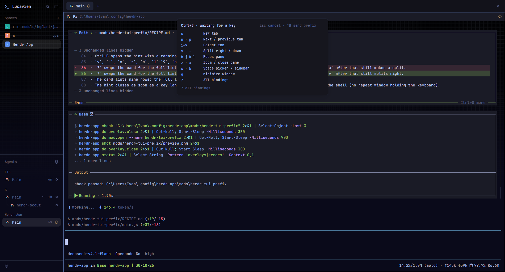

# Herdr TUI prefix

Ctrl+B, then a key: the Herdr TUI's own default prefix and default bindings, inside the Herdr app. A hint stays open while you decide. This is a piece you add to your current layout, not a window or a terminal multiplexer.



This file is the brief: enough to build Herdr TUI prefix from an empty folder. The files next to it are one build of it. If they don't work on your Herdr, or you want it different, build it again from here.

## What you see

Two states of one popup near the top of the window, 520px wide and offset 64px from the top. Nothing is added to the layout.

The card Ctrl+B opens first: a heading, "Ctrl+B · waiting for a key", with "Esc cancel · ^B send prefix" on the right, then nine 20px rows — key on the left in a 66px column in the theme's accent, action on the right in the foreground. The keys worth knowing by heart: new tab, next/previous tab, select tab, split right/down, focus pane, zoom/close pane, space picker/sidebar, minimize window, all bindings. A footer reads "? all bindings". The popup is only as tall as that card (about 265px).

The full list after `?`: the heading becomes "Ctrl+B · all bindings" with "? short list · Esc cancel" on the right, and the card gives way to a 440px scrolling list in four captioned sections — PANES, TABS, SPACES, SESSION — captions 10px semibold in the dim color. Rows are the same 20px shape, with a short reason on the right where one is needed. Rows with no Herdr-app command stay in their herdr-tui place, dimmed: `r` resize mode, `[` copy mode, `tab` / `shift+tab` cycle pane, `e` edit scrollback, `shift+p` rename pane, `shift+r` reload config, `o` notification target. A footer reads "herdr-tui defaults, herdr --default-config".

Both states use the popup background, 12px text, 14px padding and 8px gaps, and the popup shrinks to whichever state is showing.

## How it behaves

Ctrl+B opens the card and waits without a timeout. The next key acts (herdr-tui's `herdr --default-config` defaults):

| Key | Action |
| --- | --- |
| `v` / `-` | Split right / down |
| `h j k l` | Focus left / down / up / right |
| `H J K L` | Swap the focused pane left / down / up / right |
| `z` | Toggle pane zoom |
| `x` | Close the focused pane and end its terminal |
| `c` | New tab |
| `n` / `p` | Next / previous tab |
| `1`–`9` | Select tab 1–9 |
| `shift+t` / `shift+x` | Rename / close the active tab (Herdr asks the name itself) |
| `shift+n` / `shift+w` / `shift+d` | New / rename / close space (Herdr asks) |
| `shift+g` | New worktree (the shipped `worktree` dialog) |
| `w` | Space picker (the shipped `picker` popup) |
| `b` | Toggle the sidebar |
| `g` | Go to an agent or terminal (the same `picker`) |
| `s` | Settings |
| `?` | Swap the card for the full list, and back; nothing else runs and the popup stays open |
| `q` | Minimize the window; there is no detach, panes keep running |
| Escape | Cancel |
| Ctrl+B | Send a literal Ctrl+B to the focused terminal |

A dimmed row runs nothing: it closes the hint and posts a warning toast that names the action and says what to do instead (for example "Resize mode: drag a split's border.").

One key, then the hint closes: a bound key runs its action, an unbound one only dismisses, and Escape cancels. `?` is the exception — it toggles the full list and keeps the popup open. There is no repeat window, so a key you type right after the action reaches the terminal immediately. Typing outside the hint is untouched.

## Built from

- **One mod**, `mods/herdr-tui-prefix/`, `main.js` and `mod.json`. The manifest is `{"place": "none", "title": "Herdr TUI prefix", "overlay": {"kind": "popup", "at": "top", "offset": 64, "width": 520, "height": 560}}`, so no `layouts/` folder and no layout edit.
- **A `keys.json` snippet**, merged into the person's keys rather than replacing them:

  ```json
  {
    "global": { "ctrl-b": "mod.open:herdr-tui-prefix" },
    "terminal": { "ctrl-b": "mod.open:herdr-tui-prefix" },
    "mod:herdr-tui-prefix": { "ctrl-b": "herdr-tui-prefix.send-prefix" }
  }
  ```

  The terminal section is what makes Ctrl+B work while a terminal has focus; the mod section wins while the popup is open, delivering `herdr-tui-prefix.send-prefix` through `nextCommand()`.
- **Data:** `SECTIONS`, a list of `[caption, rows]` where each row is `[key, label, command, args, note]`. `command` is a command name, a function (for the two picker popups and the worktree dialog), or `null` (no equivalent, `note` is the reason). `SHORT` is the card's nine `[keys, label]` pairs. An `INDEX` map built from `SECTIONS` once at load is what a pressed key is looked up in, so both states share one table and one renderer row.
- **A focusable view** on `gpui-kit` + `gpui-base`: `cx.focus_handle()` focused in `init`, `.track_focus(handle)`, `.on_key_down`, colors from `theme()`. It closes with `closeOverlay(props().overlay)`.
- **Commands:** `pane.split`, `pane.go`, `pane.swap`, `pane.zoom`, `pane.close`, `tab.new`, `tab.next`, `tab.prev`, `tab.select`, `tab.rename`, `tab.close`, `space.new`, `space.rename`, `space.close`, `layout.toggle`, `window.minimize`, `app.settings`.
- **Overlays:** `openOverlay({mod: "picker", kind: "popup", at: "top", offset: 40, width: 640, height: 0.8})` and `openOverlay({mod: "worktree", kind: "dialog", width: 460, height: 280, props: {space, folder, action: "new"}})` with `focused().space` / `focused().cwd`.
- **Literal keys:** `focused()?.terminal` plus `hc(["keys", terminal, "ctrl+b"])`, which reaches terminals on other machines too. This mod runs `hc` — that is the only program it starts.
- **Key matching:** the produced character (`e.key_char`) for `v - [ H J K L T X N W D G`, `e.key` with shift for `tab` / `shift+tab`, digits as typed. Modifiers other than shift never match a prefix binding. `?` toggles the two states before the table is consulted.

## Watch out

- Ctrl+B is taken from terminal programs, including tmux, as it is in herdr-tui. Ctrl+B Ctrl+B reaches them.
- The full list scrolls with the mouse or its scrollbar; there are no keys for scrolling it, because `j`/`k` are herdr-tui's own pane bindings.
- `?` is the mod's own toggle, so Herdr's key list (`app.help`) is not on the prefix: bind it in `keys.json` if you want it there.
- `q` is not detach: it minimizes the window. Panes keep running either way.
- `r`, `[`, `tab`, `shift+tab`, `e`, `shift+p`, `shift+r` and `o` have no Herdr-app command (there is no pane resize, copy mode, pane cycling, pane rename, scrollback editor, config reload or notification-target command). They are listed for muscle memory and explain themselves instead of acting.
- `w` and `g` both open the shipped `picker`: the app's picker covers tab, space and agent navigation, so the TUI's separate workspace and session pickers collapse into one.
- Rename and close space/tab open Herdr's own dialogs without a name, which is how the app asks.
- The full list has a fixed 440px body and the card grows to its nine rows; the popup follows whichever state is showing. Special characters count as one key. Follow the installed `herdr.d.ts` and `gpui-kit.d.ts`, never modify shipped mods.

## Done when

- `herdr-app check mods/herdr-tui-prefix` passes with the matching Herdr binary and home.
- Ctrl+B opens the hint with a terminal focused, and a long pause does not close it.
- `v`, `-`, `x`, `z`, `c`, `1`–`9`, `b`, `s` and `q` do what their labels say.
- `?` swaps the card for the full list and back with the popup still open and the keyboard still on it; `v` after that still splits right.
- The card lists nine rows; the full list shows all four sections with the dimmed rows and their reasons.
- The hint closes as soon as a key lands, and `h` immediately followed by Ctrl+C sends the interrupt to the shell (no repeat window holding the keyboard).
- `q` minimizes the window and the panes keep running; Ctrl+B Ctrl+B types a literal prefix into the shell.
- A dimmed row (`r`, `[`, `e`) closes the hint and posts a toast naming the action.
- Esc cancels without typing into the terminal, and typing outside the hint is unchanged.
